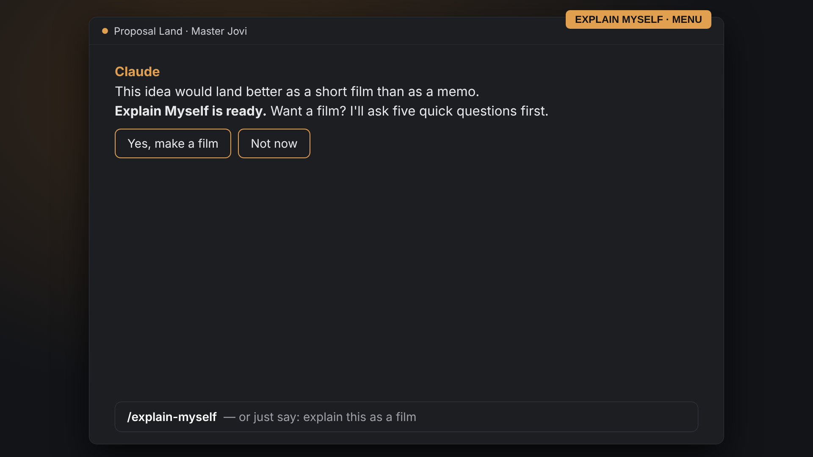
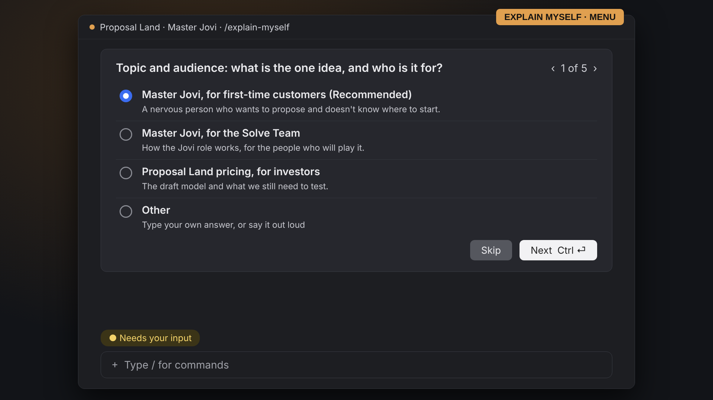
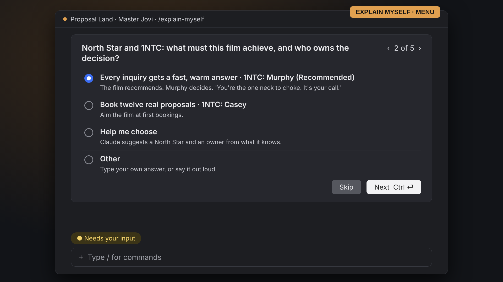
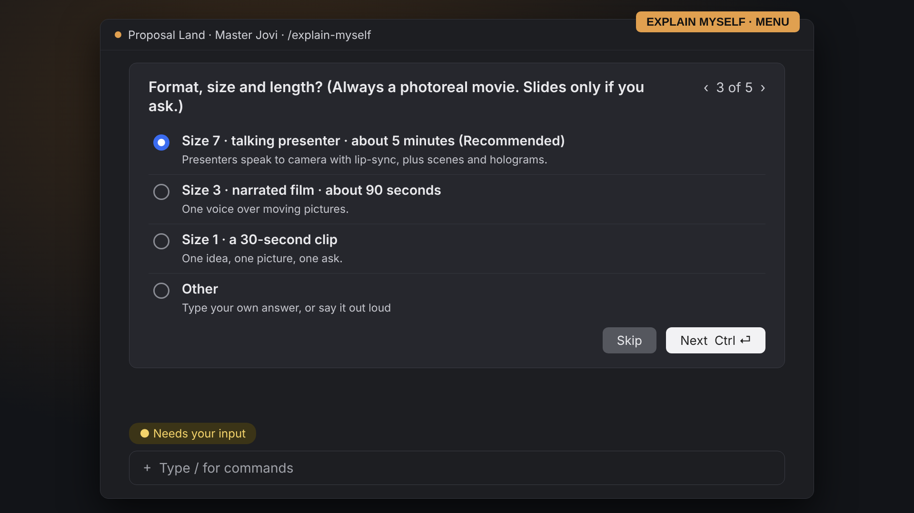
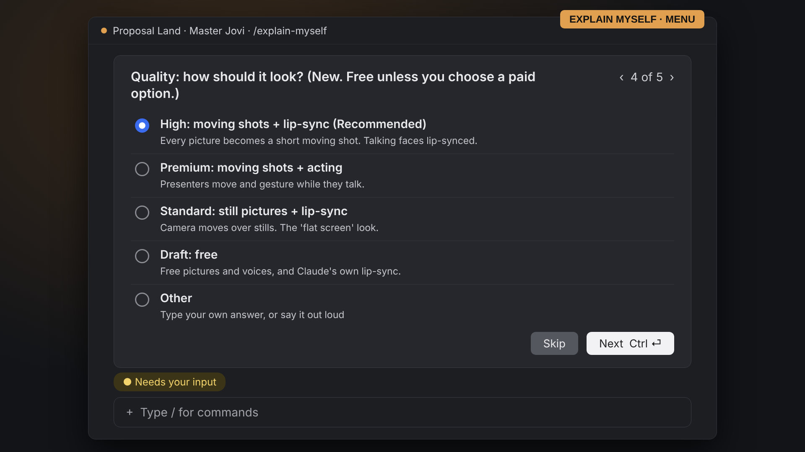
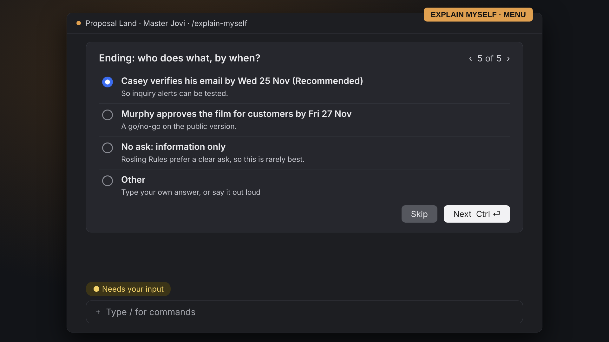

# The five menus

Claude asks these as clickable multiple-choice questions (in Claude Code and claude.ai). Each menu shows a question, up to four answers, the **recommended answer first**, and **Other** to type or say your own. Use **‹ ›** to move between questions, **Skip** to leave one for Claude to infer, **Next** (Ctrl+Enter) to go on. You can also just say your answers out loud.

| # | Menu | Picture |
|---|---|---|
| 0 | The offer: "Explain Myself is ready. Want a film?" (or type `/explain-myself`) |  |
| 1 | Topic and audience |  |
| 2 | North Star and 1NTC (the one neck to choke) |  |
| 3 | Format, size and length (always a movie unless you ask for slides) |  |
| 4 | Quality (new in v0.5): Draft free, Standard, High, Premium |  |
| 5 | Ending: who does what, by when |  |

The pictures are faithful mock-ups of the real menu, filled with the answers Tim gave for the Master Jovi film.
